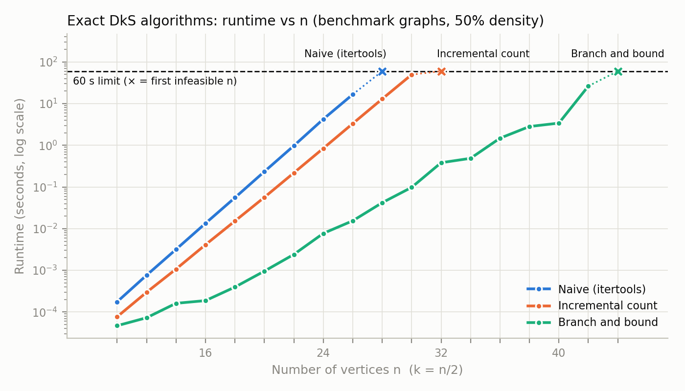
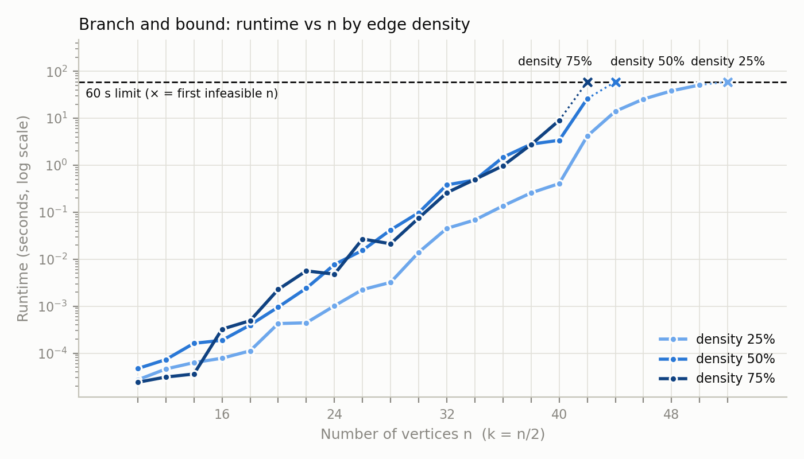

# Exact DkS Experiments: Brute Force and Branch and Bound

These experiments measure how far exact algorithms for Densest k-Subgraph can scale before they become too slow. Everything comes from `experiments/benchmark_exact.py`. The raw numbers are in `exact_benchmark.csv`.

## Algorithms

| Method | Code | Idea | Work |
|---|---|---|---|
| Naive brute force | `brute_force_naive` (`dks/brute_force.py`) | Use `itertools.combinations` to list every k-subset and count its edges from scratch | Θ(C(n,k)·k) |
| Incremental brute force | `brute_force` (`dks/brute_force.py`) | Depth-first search over subsets with a running edge count (one bitmask popcount per added vertex) | Θ(C(n,k)) |
| Branch and bound | `branch_and_bound` (`dks/branch_and_bound.py`) | The same depth-first search, but a branch is skipped when its upper bound can't beat the best answer so far. Vertices are ordered by decreasing degree, and the best answer starts as the greedy-peeling result. | Exponential worst case; prunes most of the search |

All three always return the true optimum.

## Setup

- **Graphs:** k-cluster benchmark instances from CEDRIC/CNAM (`Dataset/`), instance 1 of each family, at 25%, 50% and 75% edge density.
  - n = 10–38: the first n vertices of `PB1_d*.txt` (40 vertices), keeping only edges between those vertices.
  - n = 40: `PB1_d*.txt` in full.
  - n = 42–78: the first n vertices of `ALEA1n80_d*_method2.txt`.
  - n = 80, 100, 120, 140, 160: full instances. These were scheduled but never reached.
- **k = n/2**, the size with the most subsets (largest C(n, k)), so the hardest case.
- **Densities:** the brute-force methods do the same work at every density, so they ran only at 50%. Branch and bound ran at all three.
- **Timing:** each run happens in its own process. Runs that finish in under 0.2 s are repeated (up to 50 times) and averaged.
- **Time limit:** 60 s per run. A run that goes over is marked *infeasible*, and larger n are skipped for that method and density.
- **Code:** pure Python, single-threaded. Absolute times depend on the machine, so the relative growth matters more than the exact seconds.

Reproduce with:

```bash
python3 experiments/benchmark_exact.py              # full run
python3 experiments/benchmark_exact.py --limit 5    # quick smoke run
python3 experiments/benchmark_exact.py --plot-only  # redraw figures from the CSV
```

## Results

### Runtime at 50% density (k = n/2)

| n | C(n, k) | Naive (s) | Incremental (s) | Branch & bound (s) | Optimum (edges) |
|---:|---:|---:|---:|---:|---:|
| 10 | 252 | 0.00018 | 0.00008 | 0.00005 | 9 |
| 12 | 924 | 0.00077 | 0.00030 | 0.00007 | 12 |
| 14 | 3,432 | 0.0032 | 0.0011 | 0.00016 | 16 |
| 16 | 12,870 | 0.013 | 0.0041 | 0.00019 | 20 |
| 18 | 48,620 | 0.055 | 0.015 | 0.00040 | 24 |
| 20 | 184,756 | 0.23 | 0.057 | 0.00096 | 32 |
| 22 | 705,432 | 0.98 | 0.22 | 0.0024 | 37 |
| 24 | 2,704,156 | 4.25 | 0.85 | 0.0077 | 44 |
| 26 | 10,400,600 | 16.6 | 3.32 | 0.015 | 52 |
| 28 | 40,116,600 | > 60 | 13.0 | 0.042 | 61 |
| 30 | 155,117,520 | — | 49.7 | 0.098 | 69 |
| 32 | 601,080,390 | — | > 60 | 0.38 | 78 |
| 34 | 2.3 × 10⁹ | — | — | 0.49 | 91 |
| 36 | 9.1 × 10⁹ | — | — | 1.48 | 100 |
| 38 | 3.5 × 10¹⁰ | — | — | 2.82 | 113 |
| 40 | 1.4 × 10¹¹ | — | — | 3.41 | 130 |
| 42 | 5.4 × 10¹¹ | — | — | 26.3 | 138 |
| 44 | 2.1 × 10¹² | — | — | > 60 | — |

Wherever more than one method finished, they found the same optimum.



### Largest instance solved within 60 s

| Method | Density | Largest n solved | Time at that n | First infeasible n |
|---|---|---:|---:|---:|
| Naive | 50% | 26 | 16.6 s | 28 |
| Incremental | 50% | 30 | 49.7 s | 32 |
| Branch & bound | 25% | 50 | 51.4 s | 52 |
| Branch & bound | 50% | 42 | 26.3 s | 44 |
| Branch & bound | 75% | 40 | 9.0 s | 42 |

### Branch and bound across densities

| n | 25% time (s) | 50% time (s) | 75% time (s) | Search nodes at 25% / 50% / 75% |
|---:|---:|---:|---:|---|
| 20 | 0.00043 | 0.00096 | 0.0023 | 309 / 758 / 1,981 |
| 30 | 0.014 | 0.098 | 0.075 | 8,974 / 66,549 / 51,450 |
| 40 | 0.41 | 3.41 | 9.04 | 195,332 / 1,697,273 / 4,729,409 |
| 50 | 51.4 | — | — | 21,559,719 / — / — |



## Takeaways

1. **Brute force grows as fast as C(n, k).** Each +2 in n makes both brute-force methods about 4× slower, because that's how fast C(n, n/2) grows.
2. **Incremental counting helps only a little.** It costs about 0.32 µs per subset versus about 1.6 µs for naive, so it's 4–5× faster. But that only buys about 4 more vertices (n = 30 vs. 26) before hitting the time limit.
3. **Pruning matters far more than faster counting.** At n = 30, branch and bound takes 0.1 s while incremental brute force takes 50 s, about 500× faster. Branch and bound also reaches n = 42 at 50% density, a graph with 5 × 10¹¹ candidate subsets.
4. **Sparser graphs are easier for branch and bound.** Its limit falls from n = 50 at 25% density to n = 42 at 50% and n = 40 at 75%. In denser graphs more subsets come close to the optimum, so the upper bound prunes less.
5. **Exact methods can't handle the full benchmark sizes.** No exact method got close to the 80–160-vertex benchmark instances within 60 s. Those sizes need heuristics such as greedy peeling and local search, measured against the published optima.

## Limitations

- Each data point is one graph instance timed once (repeated runs are only for very fast cases), so there are no error bars.
- The smaller graphs are the first n vertices of larger graphs, not separately generated random graphs.
- Only k = n/2 was tested. Smaller or larger k means far fewer subsets, which would let brute force reach bigger n.
